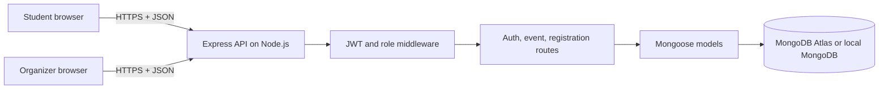

# Alternative Assessment Project Report

## CampusConnect - Campus Event Discovery and Booking System

**Submitted by:** [Student name]  
**USN / ID:** [Student ID]  
**Department:** [Department]  
**Semester / Section:** [Semester and section]  
**Subject:** Full Stack Technologies  
**Assessment:** AAT-1  
**Repository:** [nandanvinayan/campusconnect-event-booking](https://github.com/nandanvinayan/campusconnect-event-booking)

---

## 1. Project Title

**CampusConnect - Campus Event Discovery and Booking System.** CampusConnect is a web application where organizers publish campus events and students discover events, reserve seats, cancel tickets, and check in at the venue.

## 2. Problem Statement and Objectives

### Problem statement

Information about college talks, club events, workshops, performances, and sports activities is often spread across posters, messages, and separate social media accounts. Students can miss registration deadlines or arrive after an event has reached its seating limit. Organizers may collect attendance through spreadsheets or messages, making it difficult to see remaining capacity and keep an accurate guest list.

The main operational challenges are:

- **Fragmented discovery:** Students must check several channels to learn what is happening.
- **Unclear availability:** Event pages and posters do not always show whether seats remain.
- **Manual registration:** Organizers reconcile form responses, messages, and attendee lists.
- **Unreliable check-in:** Attendance updates do not always reach the organizer's main list.

### Objective

Build a secure role-based web application that lets organizers manage event listings and gives students one place to find events, reserve seats, and manage tickets.

1. Provide account registration and login for students and organizers.
2. Let organizers publish events with descriptions, dates, venues, categories, and capacity.
3. Let students browse and search upcoming published events.
4. Prevent reservations from exceeding event capacity, including during concurrent requests.
5. Let students cancel confirmed tickets and return seats to the available count.
6. Let event owners view guests and check confirmed attendees in.
7. Validate untrusted input, hash passwords, protect routes by role, and document a clean local setup.

## 3. Technologies and Tools Used

| Area | Technology / Tool | Purpose |
|---|---|---|
| Front end | HTML5, CSS3 | Accessible page structure and responsive styling |
| Browser scripting | Vanilla JavaScript, Fetch API | Page behavior, API requests, and safe DOM rendering |
| Runtime | Node.js 18+ | Server-side JavaScript runtime |
| Web framework | Express 4 | API routes, JSON parsing, static file hosting, and middleware |
| Database | MongoDB Atlas or local MongoDB | Stores users, events, and registrations |
| ODM | Mongoose 8 | Schemas, validation, indexes, references, and queries |
| Authentication | jsonwebtoken (JWT) | Signed bearer token with a seven-day default expiry |
| Password security | bcryptjs | Password hashing with ten salt rounds |
| Configuration | dotenv | Loads database and token secrets from `.env` |
| API workflow | Postman | Collection for exercising the HTTP API |
| Browser checks | Playwright | Role-based browser flows and screenshot capture |
| Version control | Git, GitHub | Local history and remote repository hosting |
| Editor and scripts | VS Code, npm | Development environment and project commands |

The same JavaScript language is used in the browser and server. MongoDB stores event and ticket documents; Mongoose provides schema validation and a partial unique index for active tickets. The browser uses no front-end framework, so the request and response flow remains easy to follow.

## 4. Project Description and Architecture

CampusConnect has three layers: the browser presents the student and organizer dashboards, the Express API authenticates requests and applies reservation rules, and MongoDB stores the application records.



### Data model

- **User:** name, normalized email, bcrypt password hash, and role (`student` or `organizer`).
- **Event:** organizer, title, description, category, venue, start time, capacity, registered count, and status (`published` or `cancelled`).
- **Registration:** event, student, status (`confirmed`, `cancelled`, or `attended`), active-ticket flag, and registration / cancellation / check-in timestamps.

A partial unique index on event and student applies while `active` is true. This allows one active ticket per person per event while retaining cancelled ticket history.

### Role permissions

| Role | Main capabilities |
|---|---|
| Organizer | Create and update owned events, cancel owned events, view their guest lists, check in guests |
| Student | Browse events, reserve a seat, view tickets, cancel a confirmed ticket |

## 5. Implementation and Methodology

### Development approach

The implementation is organized into configuration, data models, authentication middleware, API routes, browser assets, and seed / documentation files. The demo seeder creates two role-based accounts and five upcoming events so the main workflow can be demonstrated after installation.

### Authentication and roles

Account creation validates the name, email, password length, and requested role. bcryptjs stores a password hash. Login compares the entered password with that hash and returns a signed JWT. The auth middleware reads the bearer token, resolves the account, and checks role access on protected routes. Event ownership checks prevent one organizer from managing another organizer's event.

### Seat reservation

The API conditionally increments an event's `registeredCount` only when the event is published, in the future, and still below capacity. It then creates a registration. If a duplicate active ticket or another database error prevents the registration from being saved, the seat count is rolled back. This keeps concurrent reservations from exceeding capacity.

### Cancellation and check-in

A student can cancel only a confirmed active ticket. The API claims that ticket with a conditional update, decrements the event's count, and restores the ticket if the count cannot be updated. Organizers can change a confirmed ticket to attended only when they own the linked event. Completed tickets cannot be cancelled or checked in a second time.

### User interface

The sign-in and account creation screen routes users to the dashboard for their role. Students can search by event title, description, and venue, filter by category, reserve available seats, and review ticket status. Organizers can publish events, inspect capacity, expand a guest list, check attendees in, and cancel an event. Dynamic values are written through DOM APIs and `textContent`.

## 6. Important Implementation Details

### Capacity-guarded reservation

```js
const event = await Event.findOneAndUpdate(
  {
    _id: eventId,
    status: 'published',
    startsAt: { $gt: new Date() },
    $expr: { $lt: ['$registeredCount', '$capacity'] },
  },
  { $inc: { registeredCount: 1 } },
  { new: true },
);
```

The query and increment happen as one atomic update to the event document.

### Active ticket uniqueness

```js
registrationSchema.index({ event: 1, student: 1 }, {
  unique: true,
  partialFilterExpression: { active: true },
});
```

Cancelled ticket documents remain available for history but no longer prevent a later booking.

### Route protection

```js
router.post('/events', auth(['organizer']), createEvent);
router.post('/registrations/event/:eventId', auth(['student']), reserveSeat);
```

The event and registration handlers also verify resource ownership and ticket status before making changes.

## 7. Validation and Test Plan

The project includes a Postman collection and Playwright scripts. The test plan covers these cases; run the scripts locally after setting up MongoDB and installing the Playwright browser.

| No. | Scenario | Expected result |
|---:|---|---|
| 1 | Register with invalid email or a short password | `400` response with a readable validation message |
| 2 | Register with an email already in use | `409` response |
| 3 | Log in with the wrong password | `401` response |
| 4 | Student requests an organizer-only route | `403` response |
| 5 | Submit malformed or invalid event details | `400` response |
| 6 | Reserve the final seat concurrently | At most one request receives the last seat |
| 7 | Reserve a seat on a full or cancelled event | `409` response and unchanged capacity |
| 8 | Submit a duplicate active ticket | `409` response and no extra seat counted |
| 9 | Cancel a confirmed ticket | Ticket becomes cancelled and one seat is released |
| 10 | Cancel or check in the same ticket a second time | `409` response; ticket remains in its final state |
| 11 | Organizer checks in a ticket for another organizer's event | `404` response |
| 12 | Student and organizer sign-in flows in the browser | Correct dashboard and screenshot captured |

The scripts are located in `tests/campusconnect.spec.js` and `docs/CampusConnect.postman_collection.json`. The test commands and setup steps are in the README.

## 8. Output Screenshots and Repository

The Playwright scripts save full-page student and organizer dashboard screenshots under `docs/screenshots/` when executed. The repository includes the Express server, Mongoose models, routes, browser interface, demo seed script, API collection, browser checks, and this report.

**GitHub repository:** [nandanvinayan/campusconnect-event-booking](https://github.com/nandanvinayan/campusconnect-event-booking)

## 9. Challenges and Resolutions

1. **Concurrent seat requests:** A simple read-then-write can oversell the event. A conditional atomic update protects the event capacity.
2. **Duplicate ticket requests:** A button may be submitted more than once. A partial unique index permits only one active registration per student and event.
3. **Seat count drift on cancellation:** Ticket and event updates are separate writes. Conditional ticket transitions and rollback logic keep the count consistent if a later step fails.
4. **Untrusted request values:** Route handlers validate strings, dates, numbers, and object identifiers before querying or saving data.
5. **Safe display of user content:** Browser code creates text nodes and uses `textContent` rather than interpolating event descriptions into HTML.
6. **Owner-only event management:** Organizer routes check both the authenticated role and ownership of each event before exposing guest information or editing it.

## 10. Learning Outcomes and Conclusion

### Learning outcomes

- Connected browser forms, REST endpoints, role-aware middleware, and MongoDB documents.
- Practiced password hashing, signed tokens, and server-side authorization.
- Applied atomic updates and unique indexes to protect seat availability.
- Built a responsive interface with vanilla JavaScript and safe DOM updates.
- Used seed data, Postman, Playwright, Git, npm, and environment-based configuration.

### Conclusion

CampusConnect provides a central flow for campus event discovery and attendance. Students can find events and manage tickets, while organizers can publish events and review attendance. The application demonstrates a complete JavaScript web stack with role-based access and capacity-aware booking.

### Future scope

Possible extensions include email reminders, QR-based check-in, club and department verification, event waitlists, calendar export, attendance analytics, and deployment to a hosted Node.js and MongoDB environment. Production use should replace self-selected organizer roles with an approval or invitation process.
